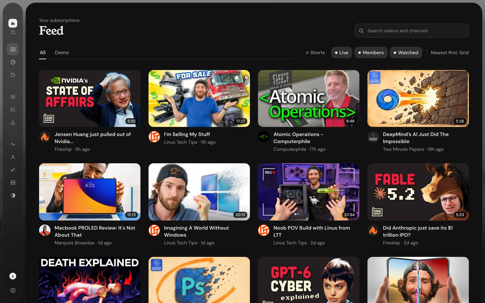

<div align="center">
  <picture>
    <source srcset="docs/icon-dark.svg" media="(prefers-color-scheme: dark)">
    <source srcset="docs/icon-light.svg" media="(prefers-color-scheme: light)">
    
  </picture>
  <h1>TubeShelf</h1>
  <h3>Self-hosted YouTube subscription feed<br />chronological, distraction-free, yours.</h3>
</div>

> [!WARNING]
> TubeShelf is in early development. Expect breaking changes and bugs; feedback and contributions are welcome.

Your YouTube subscriptions in a clean, chronological feed, without a Google account: no algorithm, no tracking.



## Features

- **Chronological feed** from YouTube's public RSS feeds: no Google account, no API key
- **Filters** for Shorts, live streams, members-only and watched videos; search; lists of channels
- **Built-in player** that resumes, marks videos watched and skips sponsors (SponsorBlock)
- **Watch later, history, import/export** (OPML, Google Takeout, plain lists)
- **Private**: thumbnails and avatars are served by TubeShelf; your browser only contacts YouTube when you press play
- **Multi-user** with local accounts, OIDC sign-in and API keys
- **Small**: one static Go binary, about 6 MB to pull

## Quick start

```yaml
services:
  tubeshelf:
    image: ghcr.io/samumatic/tubeshelf:latest
    container_name: tubeshelf
    restart: unless-stopped
    ports:
      - "3000:3000"
    user: "1000:1000"
    security_opt:
      - no-new-privileges:true
    volumes:
      - ./data:/app/data
```

```bash
mkdir -p data && chown 1000:1000 data && docker compose up -d
```

Open **http://localhost:3000** and create the admin account. Refresh interval, retention, registration, sign-in providers and branding are set in the app under **Administration**.

| Variable | Default | Purpose |
|---|---|---|
| `PORT` | `3000` | Listen port |
| `TUBESHELF_DATA` | `/app/data` | Database, cached images, generated secret |
| `TUBESHELF_URL` | from the request | Public URL, for OIDC behind a proxy that rewrites `Host` |
| `TUBESHELF_SECRET` | kept in `data/.secret` | Encrypts OIDC client secrets; set it before the first start or never |
| `TRUST_PROXY_HEADERS` | unset | `1` rate-limits logins by `X-Forwarded-For` |

## Upgrading from 1.x

Keep the `./data` volume. The first 2.x start copies users, subscriptions, lists, history, watch later, settings, API keys and sign-in providers from `data/tubeshelf.db` into `data/shelf.db`; the 1.x file stays untouched, so you can go back.

- Passwords, API keys and the OIDC redirect URI (`/api/auth/oidc/callback`) keep working.
- Keep `BETTER_AUTH_SECRET` (or `OIDC_ENCRYPTION_KEY`) set for that first start so OIDC client secrets can be decrypted; 2.x stops and says so if they can't. `TUBESHELF_IMPORT_SKIP_OIDC=1` imports without them. Afterwards the key lives in `data/.secret`: back it up with the database.
- Removed: video comments, SubRelay sync, the welcome wizard, the scraping fetcher.

## CLI and API

```bash
docker exec -it tubeshelf /tubeshelf reset-password <email>
```

```bash
docker exec tubeshelf /tubeshelf make-admin <email>
```

Create a key under **Account › API keys** and send it as `X-API-Key`:

| Request | Purpose |
|---|---|
| `GET /api/subscriptions` | List subscriptions |
| `POST /api/subscriptions` with `{"channel": "<url, @handle or id>"}` | Subscribe |
| `DELETE /api/subscriptions/<channel id>` | Unsubscribe |
| `GET /api/subscriptions/export` | OPML export |

## Development

```bash
go test ./... && go run .
```

## Why TubeShelf?

Invidious and similar projects rebuild all of YouTube. TubeShelf does one thing: a distraction-free subscription feed for your home network, played in a privacy-friendly embed or on YouTube.

## AI assistance disclaimer

This project was developed with assistance from AI/LLMs (including GitHub Copilot, ChatGPT, and related tools), supervised by humans who occasionally knew what they were doing.

## License

[AGPL-3.0](LICENSE)
