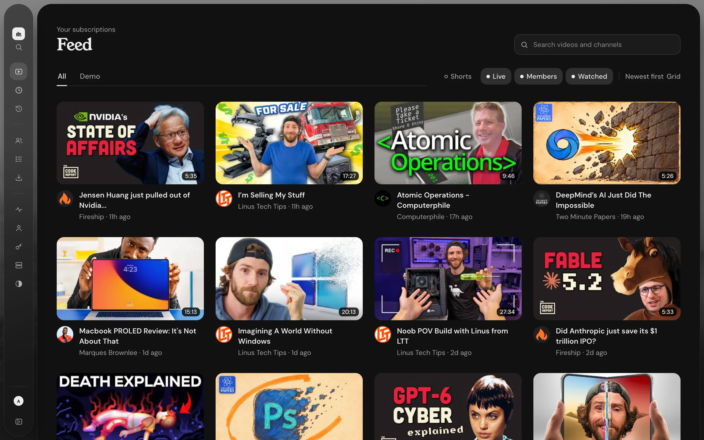

<div align="center">
  <picture>
    <source srcset="docs/icon-dark.svg" media="(prefers-color-scheme: dark)">
    <source srcset="docs/icon-light.svg" media="(prefers-color-scheme: light)">
    
  </picture>
  <h1>TubeShelf</h1>
  <h3>Self-hosted YouTube subscription feed<br />chronological, distraction-free, yours.</h3>
</div>

> [!WARNING]
> TubeShelf is in early development. Expect breaking changes and bugs; feedback and contributions are welcome.

Your YouTube subscriptions in a clean, chronological feed, without a Google account: no algorithm, no tracking.



## Features

- **Chronological feed** from YouTube's public RSS feeds: no Google account, no API key; a new channel also brings its recent uploads from its channel page
- **Comments** under the player, loaded through TubeShelf
- **Filters** for Shorts, live streams, members-only and watched videos; search; lists of channels
- **Built-in player** that resumes, marks videos watched and skips sponsors (SponsorBlock)
- **Watch later, history, import/export** (OPML, Google Takeout, plain lists)
- **Private**: thumbnails and avatars are served by TubeShelf; your browser only contacts YouTube when you press play
- **Multi-user** with local accounts, OIDC sign-in and API keys
- **Small**: one static Go binary, about 6 MB to pull

## Quick start

```yaml
services:
  tubeshelf:
    image: ghcr.io/samumatic/tubeshelf:latest
    container_name: tubeshelf
    restart: unless-stopped
    ports:
      - "3000:3000"
    user: "1000:1000"
    security_opt:
      - no-new-privileges:true
    volumes:
      - ./data:/app/data
```

```bash
mkdir -p data && chown 1000:1000 data && docker compose up -d
```

Open **http://localhost:3000** and create the admin account. Refresh interval, retention, registration, sign-in providers and branding are set in the app under **Administration**.

| Variable | Default | Purpose |
|---|---|---|
| `PORT` | `3000` | Listen port |
| `TUBESHELF_DATA` | `/app/data` | Database, cached images, generated secret |
| `TUBESHELF_URL` | from the request | Public URL, for OIDC behind a proxy that rewrites `Host`; an `https://` URL also marks cookies Secure |
| `TUBESHELF_HOST` | all addresses | Listen address |
| `TUBESHELF_SECRET` | kept in `data/.secret` | Encrypts OIDC client secrets; set it before the first start or never |
| `TRUST_PROXY_HEADERS` | unset | `1` rate-limits logins by `X-Forwarded-For` |

## CLI and API

```bash
docker exec -it tubeshelf /tubeshelf reset-password <email>
```

```bash
docker exec tubeshelf /tubeshelf make-admin <email>
docker exec tubeshelf /tubeshelf user-list
docker exec tubeshelf /tubeshelf oidc-status
docker exec tubeshelf /tubeshelf oidc-toggle [enable|disable]
```

Create a key under **Account › API keys** and send it as `X-API-Key`:

| Request | Purpose |
|---|---|
| `GET /api/subscriptions` | List subscriptions |
| `POST /api/subscriptions` with `{"channel": "<url, @handle or id>"}` | Subscribe |
| `DELETE /api/subscriptions/<channel id>` | Unsubscribe |
| `GET /api/subscriptions/export` | OPML export |
| `GET /api/videos?q=<text>` | Search your feed (up to 8 videos) |

## Sign-in with OIDC

Under **Administration › Sign-in**, add a provider (Pocket ID, Authentik, Authelia, Keycloak, Google and others):

1. At the provider, create an OIDC client with the redirect URI shown on that page (`<your URL>/api/auth/oidc/callback`).
2. Enter the issuer URL, client ID and secret. The issuer is checked when you save.
3. To manage admins at the provider, add `groups` to the scopes and set the group claim and admin group. People signing in through that provider without the group lose admin rights; the last admin always keeps them.

Behind a reverse proxy, set `TUBESHELF_URL` so the redirect URI uses your public address.

## Backup and upgrade

```bash
docker exec tubeshelf /tubeshelf backup /app/data/backup-$(date +%F).db
```

The backup is consistent while TubeShelf runs. Keep it with `data/.secret` (unless you set `TUBESHELF_SECRET`) and `data/branding`; thumbnails and avatars are fetched again.

To upgrade, pull the new image and run `docker compose up -d`. Database changes apply on start. A TubeShelf 1.x database (`data/tubeshelf.db`) is imported on the first start of 2.x and left untouched.

## Troubleshooting

- **No videos after adding channels**: the first fetch takes a minute. **Administration › Status** lists channels that fail, with the reason, and lets you retry or remove them.
- **Lengths missing, logs mention bot checks**: YouTube is rate-limiting this server's address. TubeShelf waits and tries again on its own; lower *Channels checked at once* under **Administration › Instance**.
- **Videos do not play**: YouTube may be blocked on your network, or the video was removed. The player offers *Open on YouTube*.
- **Locked out**: `docker exec -it tubeshelf /tubeshelf reset-password <email>`; `oidc-toggle disable` allows passwords again.
- **OIDC sign-in fails**: the reason is in the server log (`docker logs tubeshelf`). Usually the redirect URI differs from the one registered at the provider; set `TUBESHELF_URL`.

## Development

```bash
go test ./... && go run .
```

## Why TubeShelf?

Invidious and similar projects rebuild all of YouTube. TubeShelf does one thing: a distraction-free subscription feed for your home network, played in a privacy-friendly embed or on YouTube.

## AI assistance disclaimer

This project was developed with assistance from AI/LLMs (including GitHub Copilot, ChatGPT, and related tools), supervised by humans who occasionally knew what they were doing.

## License

[AGPL-3.0](LICENSE)
